# ShuttleCoach

**One camera in. A full coaching staff out. 100% offline.**

ShuttleCoach is a private, on-device team of AI badminton coaches. It turns a match video into 3D shuttle flight,
shot speeds and heat zones; four coach agents read it together with each player's memory, debate the week at a round
table and agree a training plan; on Telegram the team books a court that is fair to everyone. Every model runs on the
local machine, built for one Intel Arc Pro B70 (32 GB). Match video and player data never leave it.

ASUS UGen AI League 2026 · Battlefield Thunderstorm (ASUS UGen Intel Arc Pro B70 32GB) · Theme: Everyday AI · Team rm-rf-2

## Demo video and deck

[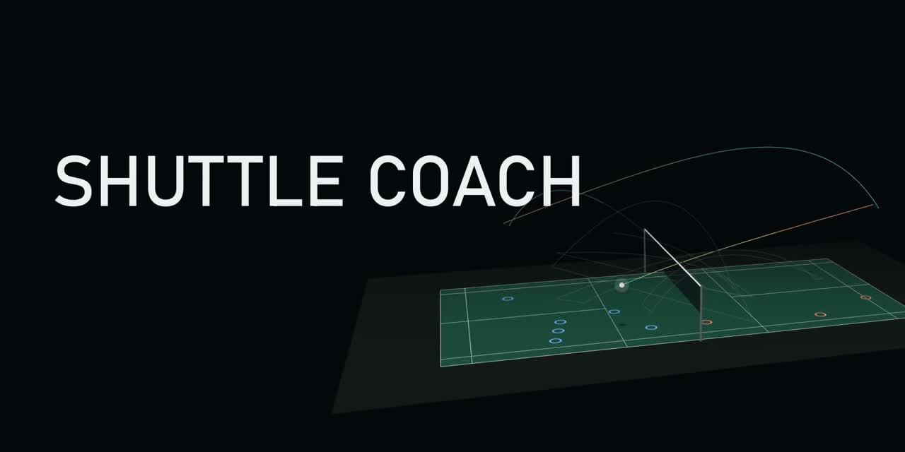](https://youtu.be/a7frKob9Zik)

| | |
|---|---|
| ▶ **Demo video** (2:57, narrated) | [Watch on YouTube](https://youtu.be/a7frKob9Zik) · [download MP4 (19 MB)](https://github.com/gino6178/ASUS_hackathon/raw/main/docs/media/ShuttleCoach_demo.mp4) |
| 📑 **Proposal deck** (20 pages) | [PDF](deck/ShuttleCoach_StageI_Proposal_v4.pdf) · [PPTX with animations](deck/ShuttleCoach_StageI_Proposal_v4.pptx) · [PPTX, static images](deck/ShuttleCoach_StageI_Proposal_v4_static.pptx) |

Click the picture to watch on YouTube.

## Features

### 1 · Match analysis and 3D replay

Drop in match footage; the station calibrates the court, tracks the shuttle in 2D and lifts every trajectory into 3D.
Each rally becomes a 3D replay with shot type, speed, height and landing spot, beside the original video.

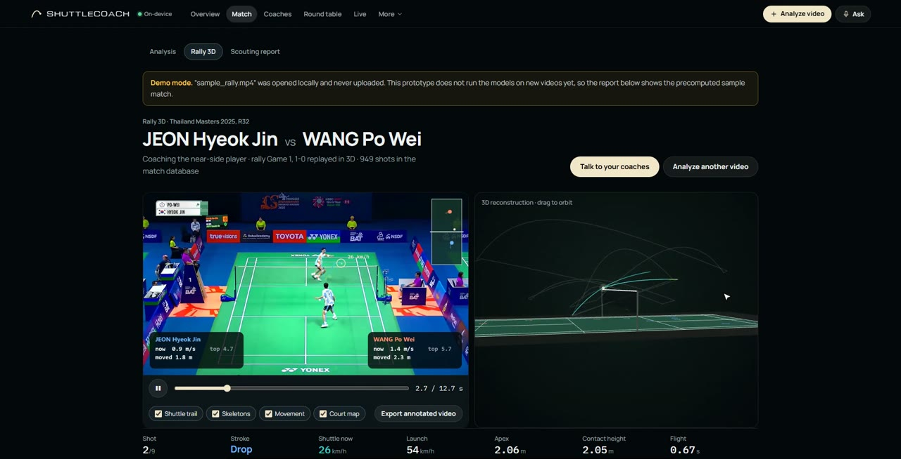

### 2 · Four coach agents

Four specialists read the same match, each in its own area, with the player's memory. Every number on screen is
computed by code; the coach explains it.

| Coach | Area | In the demo |
|---|---|---|
| **Coach Lin** | Tactics | The zone that cost the most points: rear forehand, 7 of 24 winners conceded |
| **Coach Kai** | Technique | Every shot graded A / B / C from its 3D flight |
| **Coach Ren** | Fitness | Which muscles to train on a 3D body; adapts to a sore right knee from memory |
| **Coach Ada** | Data | The opponent's habits under pressure: after a lift or clear, smashes 38% |

<p>
  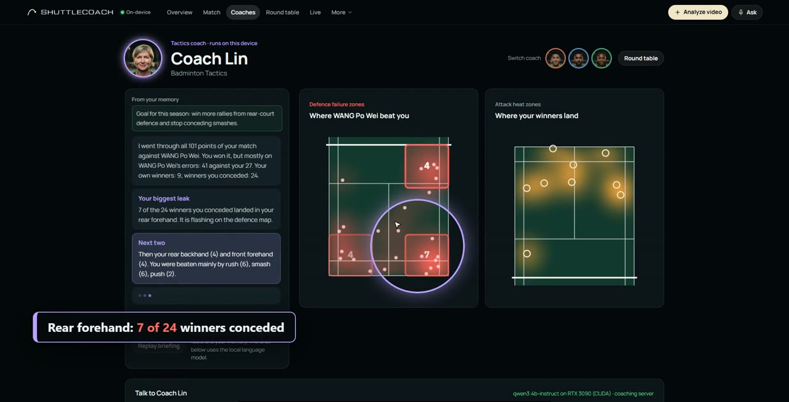
  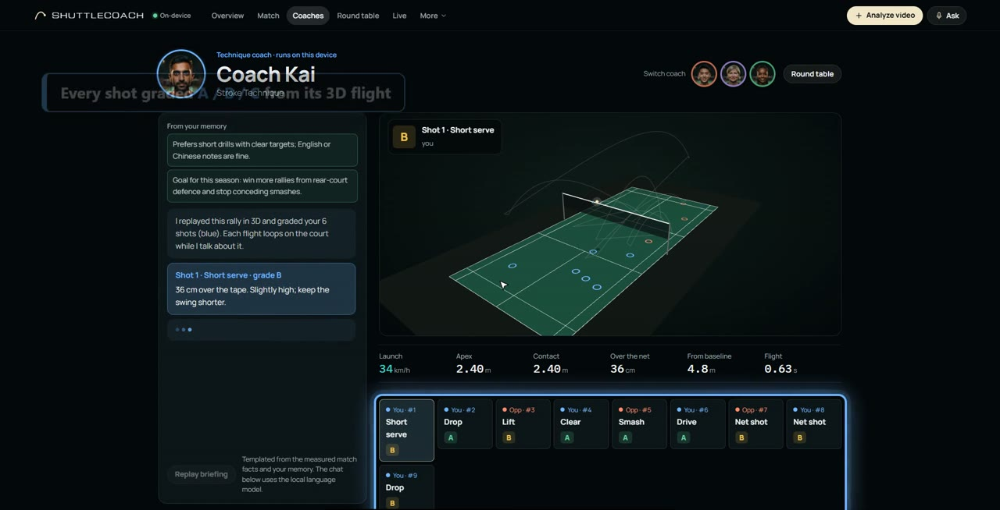
</p>
<p>
  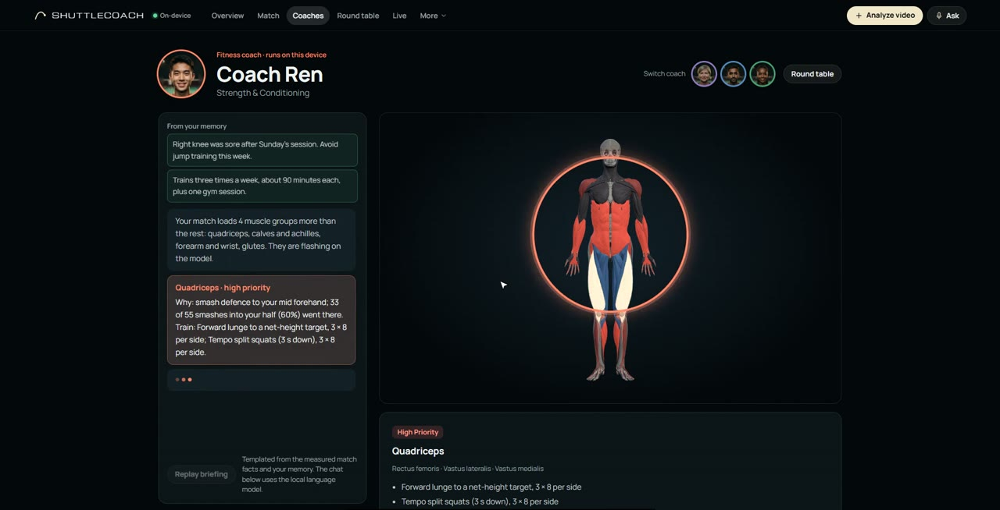
  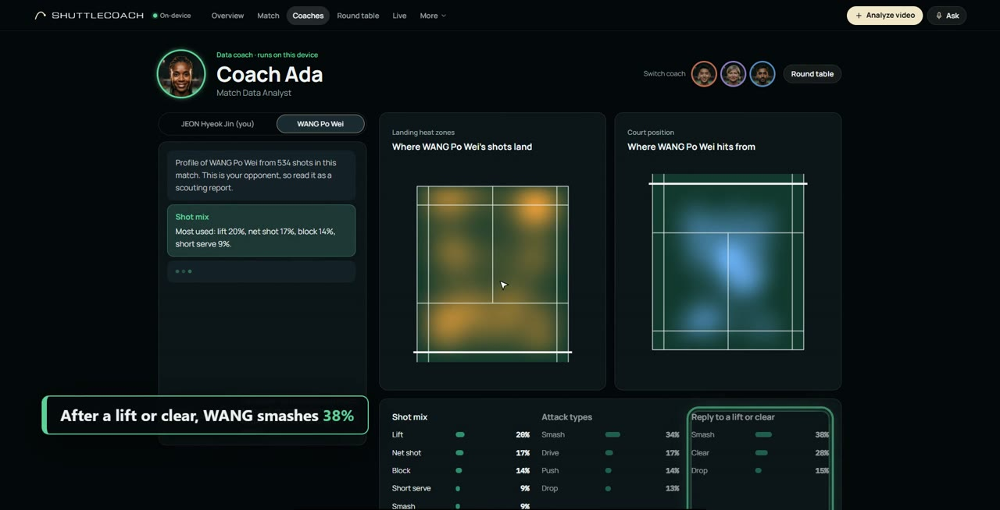
</p>

### 3 · Round table

The coaches debate the week live on the local model. Each argues for one priority from its own facts; the fitness
coach checks every request against the player's memory and challenges one that clashes. The head coach rules by
fixed priorities (health first, then the points at stake) and writes four measurable goals and a 7-day plan. Every
turn passes the number verifier.

<p>
  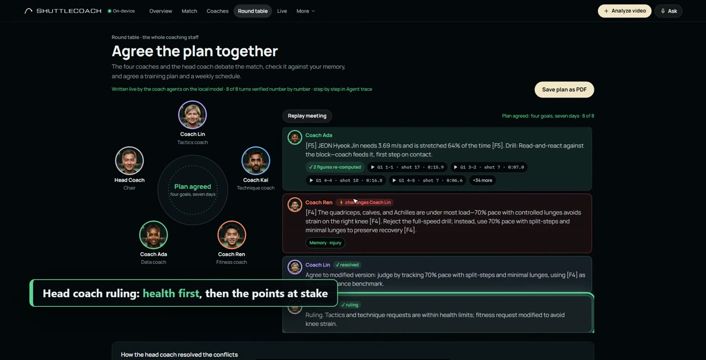
  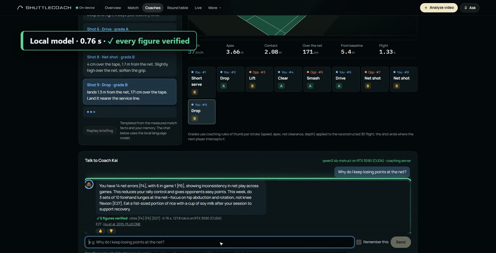
</p>

### 4 · Ask any coach

Type or speak a question. The local model answers in about a second, and a verifier checks every figure against the
match data or the cited study before the reply is shown.

### 5 · Voice coach and auto highlights

Ask by voice (Whisper runs in the browser on the device); rallies are picked and cut into highlights ready to post.

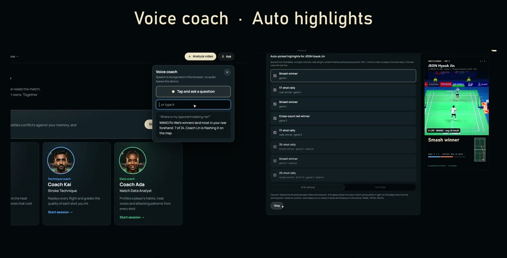

### 6 · Live mode

Between points, a short brief from the coaches; notes appear when a pattern shows up. In the prototype, recorded
rallies are streamed as if live.

### 7 · Coaches that keep learning, safely

Every night a research agent searches OpenAlex, arXiv and Semantic Scholar and adds findings to the knowledge base.
Each coach proposes changes to its own playbook. A change is adopted only if it cites a study, passes the safety
check and does not regress on the coach's test questions. Anything about health waits for a human coach, who can
decline it; every version can be rolled back.

<p>
  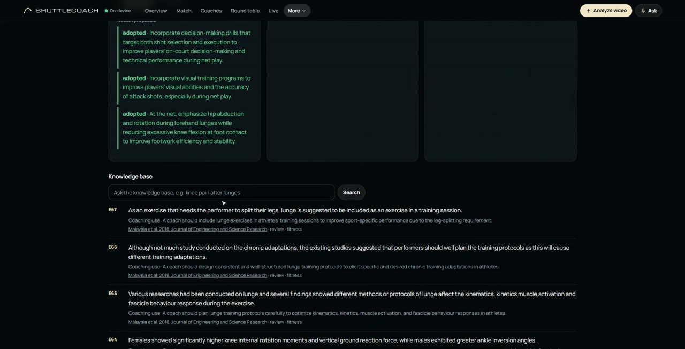
  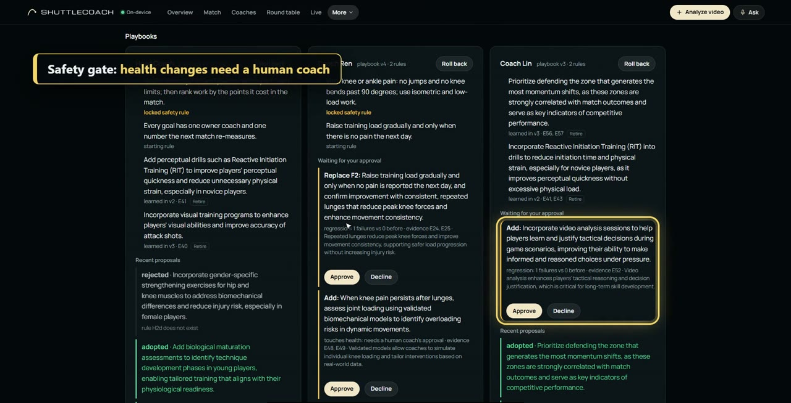
</p>

### 8 · 24-hour coach on Telegram

Between sessions the same staff lives in Telegram: meals planned from what is in the kitchen, schedule reminders,
an evening check-in that logs the session. Only text passes through Telegram; `/forget` deletes everything stored
about a player.

<p>
  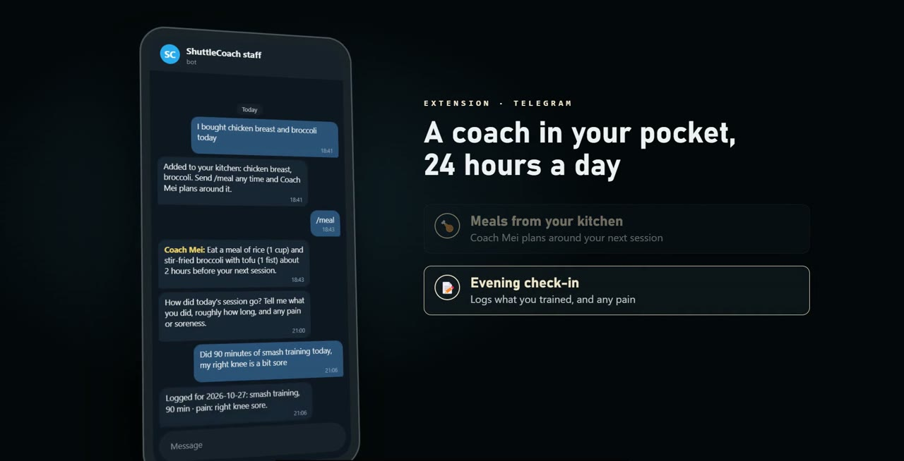
  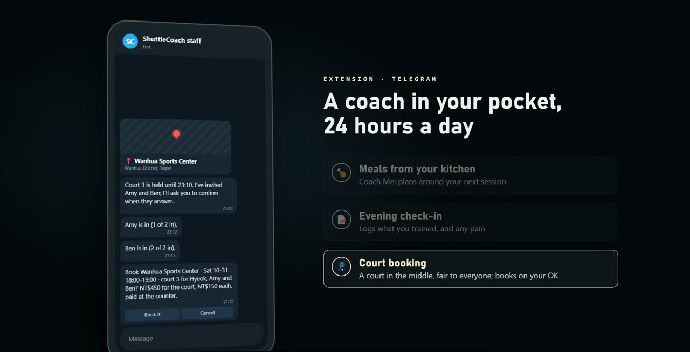
</p>

### 9 · Booking agent: a court that is fair to everyone

"Doubles with Amy and Ben on Saturday evening." The local model reads the request; the fitness coach agent sets the
length (a sore knee means 1 hour); the agent checks each player's calendar and rough area, searches 18 sports
centres and ranks free courts by the longest trip anyone would make. Then it books on the venue's website in its own
browser: code types the password (the model never sees it), and it stops before the final confirm until the player
taps "Book it".

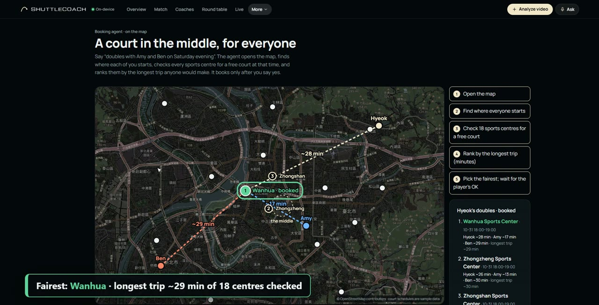
<p>
  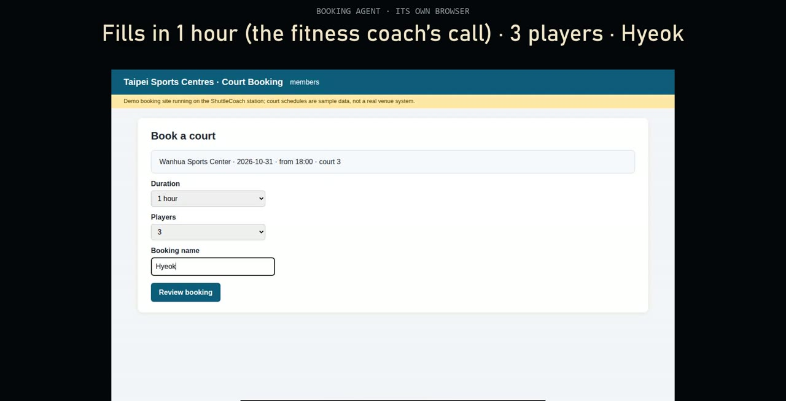
  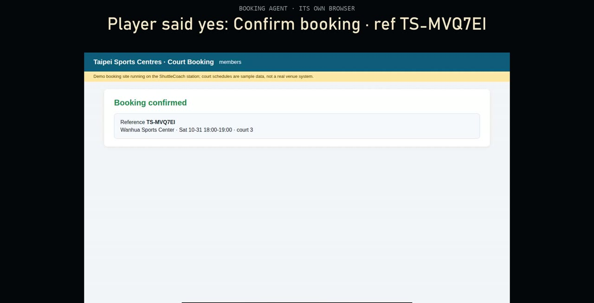
</p>

### 10 · Agent trace

Every run records its LLM calls, tool calls, checks, messages and the moments it waits for a person, step by step,
on the station.

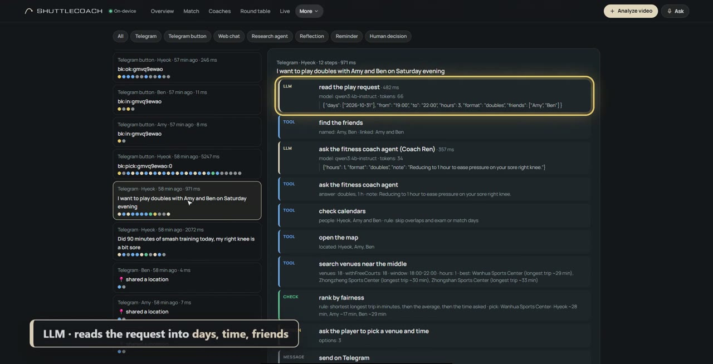

## How it works

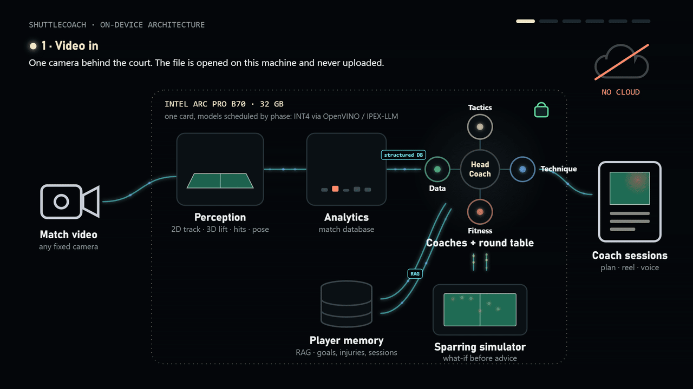

1. **Perception.** TrackNetV5 finds the shuttle in 2D; monocular 3D reconstruction gives its flight; hits and poses
   are detected. The result is structured match data: every shot, its speed, height and landing spot.
2. **Facts, not guesses.** Deterministic code computes every number. The local LLM (Qwen3-4B, 4-bit) only explains
   them, and a verifier rejects any reply whose figures do not match the data or the cited study.
3. **Coach agents with memory.** Each coach reads the facts in its own area plus the player's memory (injuries,
   schedule, feedback), and tests advice in a simulator before giving it.
4. **On one card.** The LLM runs on OpenVINO GenAI on the Arc Pro B70 (Ollama on other GPUs); the web app talks to an
   agent gateway on the same station. Nothing goes to the cloud.

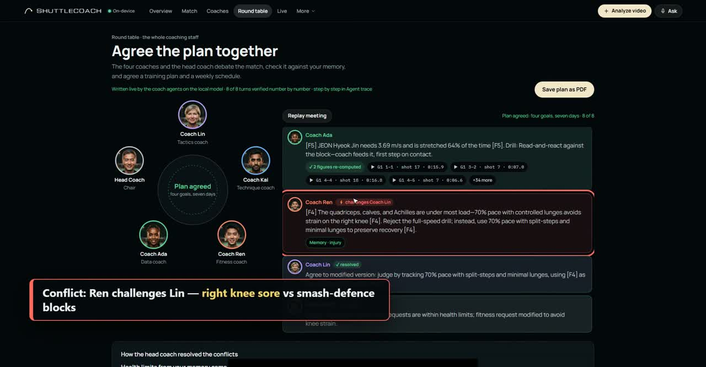

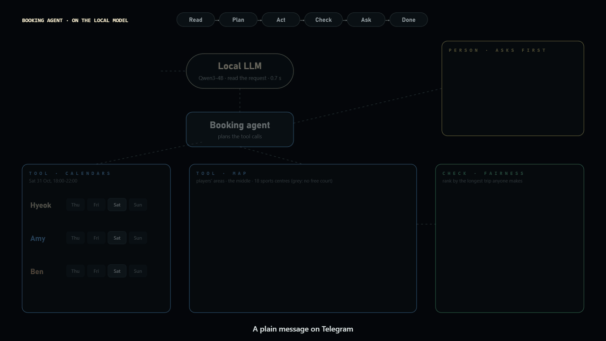

## Measured on the prototype

Measured on our test GPU (Qwen3-4B, 4-bit), from the agent trace:

| | |
|---|---|
| Coach reply, verified | 0.8 s |
| Round table, 9–10 turns | 4.0 s |
| Booking offer (calendars, 18 centres, travel times) | 3.3 s |
| Browser booking, 28 steps | 9.4 s |
| End-to-end tests | 23/23 booking · 21/21 gateway and Telegram |

Next: the same measurements on the Arc Pro B70 with the OpenVINO backend in [`llm-server/`](llm-server).

## Repository

| Folder | What it is |
|---|---|
| [`web/`](web) | The interface: React + Three.js (Vite). Match analysis, coaches, round table, live mode, voice coach, highlights, Lab |
| [`agent/`](agent) | Agent gateway (Node): grounded coach chat on a local LLM with a number verifier, player memory, the research agent and knowledge base (RAG), self-evolving playbooks, and the 24-hour coach on Telegram |
| [`llm-server/`](llm-server) | Qwen3-4B INT4 on OpenVINO GenAI behind an OpenAI-compatible API, for the Arc Pro B70 |
| [`server/`](server) | `start.sh`: starts the LLM backend (Ollama or OpenVINO) and the gateway on the coaching station |
| [`deck/`](deck) | Proposal deck (PDF, PPTX) and the scripts that build the deck and record the video |
| [`docs/`](docs) | Demo video and README media, demo video script, coach portrait prompts |

## Run it

On the coaching station (Linux, NVIDIA or Intel GPU):

```bash
cp agent/.env.example agent/.env          # set TELEGRAM_BOT_TOKEN to use the Telegram coach
BACKEND=ollama ./server/start.sh          # or BACKEND=openvino on the Arc Pro B70
```

On any machine with a browser:

```bash
cd web && npm install
echo VITE_AGENT_URL=http://<station-ip>:8787 > .env.local
npm run dev
```

End-to-end tests of the gateway and the Telegram bot (a fake Telegram API, the real local model): `cd agent && npm test` and `node test/booking.mjs`.

## The coaching staff

- **Grounded replies.** Deterministic code computes every match number; the model only explains them. A verifier
  checks each figure against the fact or study cited in the same sentence and rejects the reply otherwise.
- **Round table.** Held live by the coach agents on the local model: each argues for one priority from its own facts,
  the fitness coach checks every request against the player's memory and challenges one that clashes, the challenged
  coach answers, and the head coach rules by fixed priorities (health limits first, then points at stake). Every turn
  goes through the verifier; four measurable goals and a 7-day plan come out. Without the gateway a templated meeting
  is shown and labelled as such.
- **Self-evolving.** A research agent searches OpenAlex, arXiv and Semantic Scholar every night and keeps findings
  whose numbers appear in the abstract. Each coach then reflects on player feedback, rejected drafts and new findings,
  and proposes changes to its own playbook. A change is adopted only if it cites a study in the coach's area, passes
  the safety check and does not regress on the coach's test questions; anything about health waits for a human coach.
  Every version can be rolled back (web: Lab).
- **24-hour coach on Telegram.** Food at home and meals timed to training, the player's schedule with a reminder an
  hour before each session, the training log with an evening check-in. Only text passes through Telegram;
  `/forget` deletes everything stored about a player.
- **Booking agent.** "Doubles with Amy and Ben on Saturday evening": the local model reads the request and the fitness coach agent
  sets the length (a sore knee means 1 hour); the agent checks every player's calendar and rough area (shared on
  Telegram, rounded to about 1 km), searches 18 sports centres and ranks the free courts by the longest trip anyone
  would make, in estimated minutes by MRT and bus. Then it books on the venue's website itself, in a
  headless browser on the station: the local model reads each page and picks the next control, code types the member
  password (the model never sees it) and stops before the final confirm until the player taps "Book it"; then the agent
  confirms and reads back the booking reference (web: Find a court, Agent trace, with a screenshot per step). Venue
  names and locations are from OpenStreetMap; the booking site is a demo site on the station with sample schedules.
- **Agent trace.** Every run records its LLM calls, tool calls, checks, messages and the moments it waits for a person,
  on the station (web: Agent trace; `GET /api/trace`).

## Prototype status

- The demo opens a sample match the station has already analysed; a newly uploaded video is not analysed live yet.
- Live mode replays recorded rallies as if live.
- The booking site is a demo site on the station with sample schedules; no real court is booked.
- The Telegram scene in the video shows the end-to-end test's real output; a bot token is needed to run it on a phone.
- The narration in the video is a synthetic voice (Kokoro TTS).

## Not in this repository

- The monocular 3D reconstruction and intent detection methods (closed blocks). The app ships their precomputed outputs for the sample match in `web/public/data/`.
- The broadcast footage of the sample match (not ours to redistribute) and model weights (downloaded; see
  `llm-server/README.md` and `web/README.md`).
- Runtime data on the station: players, conversations, feedback, playbooks and the knowledge base.

## Credits

TrackNetV3 (MIT) and TrackNetV5 ([github.com/gino6178/TrackNetV5](https://github.com/gino6178/TrackNetV5)) for 2D
shuttle tracking; ShuttleSet (KDD 2023) labels; BodyParts3D 4.0, © The Database Center for Life Science, CC BY 4.0,
adapted via Human Atlas (MIT); Whisper tiny.en (MIT) via Transformers.js (Apache-2.0); MediaPipe Pose Landmarker
(Apache-2.0); Qwen3 (Apache-2.0). Coach portraits are AI-generated, fictional people.
