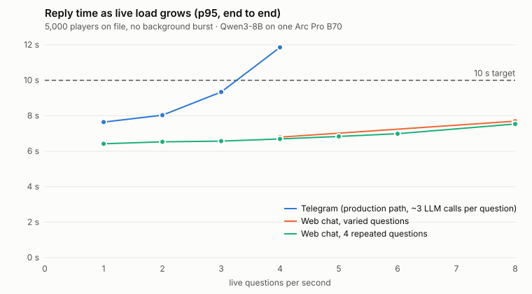

# How many players one B70 can serve

Measured on 18 Nov 2026 on the organizer's Intel Arc Pro B70 instance. Qwen3-8B bf16 runs on GPU 0 under vLLM 0.26 (XPU) with `--scheduling-policy priority`. Qwen3-Embedding-0.6B runs on GPU 1.

- Raw summaries: [`docs/bench/full-20261118/results.json`](bench/full-20261118/results.json). Every number below comes from that file.
- Generated tables: [`summary.md`](bench/full-20261118/summary.md).
- Reproduce: `bash server/b70.sh start`, `bash server/full_bench_b70.sh`, `bash server/capacity_b70.sh`. Then build the report with `node server/full_report.mjs bench/full-<timestamp>`.

## Answer

| | Live coach questions per second | Questions in the peak hour | Daily active players¹ | Registered players¹ |
|---|---:|---:|---:|---:|
| **Planning capacity** (p95 reply 8.0 s, 99% under 10 s) | 2 | 7,200 | **~12,000** | **~40,000** |
| Edge of the target (p95 9.3 s, 97% under 10 s) | 3 | 10,800 | ~18,000 | ~60,000 |
| Past the target (p95 11.9 s) | 4 | – | – | – |

¹ These figures depend on three usage assumptions, explained in [Usage assumptions](#usage-assumptions): 3 questions per active player per day, 20% of the day's questions in the peak hour, and DAU/MAU of 30%. The [range](#range) section shows how the result moves when the assumptions change.

The bottleneck is the GPU.

- Every one of the 16,410 live questions sent through the gateway in these runs was answered. None failed and none timed out.
- Reply time grows smoothly until about 3 Telegram questions per second, then climbs quickly.
- The original goal of 5,000 players is well inside one card. 5,000 registered players at the assumptions above means 0.25 questions per second in the peak hour, about 12% of planning capacity.
- Even if all 5,000 players used the app every day as heavy users, the load would be 2.1 questions per second. That is still at planning capacity.

## What similar platforms measure, and what we measured

LLM serving teams size capacity in the same three steps. We followed them.

| What is measured | How the industry does it | Ours |
|---|---|---|
| Latency per request, at the tail | Time to first token (TTFT) and time per output token (TPOT), at p95 or p99, never the mean. MLPerf Inference sets the targets for an 8B model: **TTFT ≤ 2 s and TPOT ≤ 100 ms** for the server scenario, and 0.5 s and 30 ms for the interactive scenario ([MLCommons](https://mlcommons.org/?p=3125), [HPCwire](https://hpcwire.com/2025/09/10/mlperf-inference-v5-1-results-land-with-new-benchmarks-and-record-participation), [Red Hat](https://www.redhat.com/en/blog/efficient-and-reproducible-llm-inference-red-hat-mlperf-inference-v51-results)) | TTFT and TPOT p50/p95/p99 for every model-level run, plus the end-to-end reply time a player waits for |
| Goodput | Raise the request rate until the targets break. Capacity is the highest rate at which requests still meet them ([CNCF](https://www.cncf.io/blog/2026/07/20/why-goodput-matters-more-than-throughput-for-llm-serving/), [GuideLLM walkthrough](https://lucaberton.com/blog/guidellm-vllm-benchmark-slo-kubernetes/)) | Rate sweeps at the model level (1–8/s), through the web chat (1–8/s) and through Telegram (1–4/s) |
| Users | Peak requests per second, then requests per user in the peak, then daily and monthly users. Little's law (requests in flight = arrival rate × response time) is the cross-check, and 30–40% headroom is usual ([systemdesign.one](https://newsletter.systemdesign.one/p/chatgpt-system-design), [Loadster](https://loadster.com/guides/concurrent-users/index.md), [CallSphere](https://callsphere.ai/blog/capacity-planning-llm-workloads-2026.md)) | See [From questions per second to players](#from-questions-per-second-to-players) |
| Power | Watts and throttling while loaded | GPU 0 power and clock every 5 s (`xpu-smi`). Every loaded run sat at the 230 W limit. |

ShuttleCoach's own target is the time a player waits for the coach's message: **p95 ≤ 10 s from sending a Telegram message to receiving the reply.** Replies arrive as whole Telegram messages, not as a token stream, so a per-token target only applies at the model level.

## 1. Model level: synthetic requests against vLLM

`server/loadsim.mjs` sends streaming requests with 1,600 tokens in and 120 out (`ignore_eos`), arriving as a Poisson process.

| Live requests/s | TTFT p50 / p95 | TPOT p50 / p95 | Meet MLPerf server target | Meet interactive target |
|---:|---:|---:|---:|---:|
| 1 | 0.28 / 0.50 s | 37 / 47 ms | 100% | 4% |
| 2 | 0.32 / 0.71 s | 56 / 72 ms | 100% | 0% |
| 3 | 1.38 / 5.49 s | 113 / 121 ms | 27% | 0% |
| 4 | 25.8 / 54.6 s | 116 / 121 ms | 0% (queue grows) | 0% |
| 8 | 156 / 303 s | 117 / 119 ms | 0% | 0% |

- The card tops out at **about 340 output tokens per second** for prompts of this size, which is about 2.8 requests per second. Beyond that the queue grows without bound.
- The **MLPerf server target holds up to 2 requests per second.**
- The interactive target (TPOT ≤ 30 ms) is not met even at 1 request per second. A single request already decodes at about 28 ms per token on this card (see [performance_b70.md](performance_b70.md)). Meeting it needs a smaller or quantized model, or a faster card.

## 2. Through the real gateway: web chat and Telegram

`server/scale_test.mjs` starts a separate copy of the gateway on test data: 5,000 players on file. A mock Telegram server records every message instead of sending it. Live questions arrive as a Poisson process for 4 minutes per rate.

- **Web chat** (`/api/chat`): one coach reply, about 1.25 LLM calls per question, because the number check rewrites some replies.
- **Telegram, the production path.** 500 askers each have their own memories and growing chat history, and ask varied questions. Each message goes through three model steps:
  1. The model files it (`life.read`).
  2. A coach writes the reply.
  3. The model extracts anything worth remembering.

  That is **3.1 LLM calls per question.** Latency is measured from the moment the update reaches the bot to the moment the coach's reply is sent.

| Path | Questions/s | Reply p50 / p95 / p99 | Under 10 s | LLM calls per question |
|---|---:|---:|---:|---:|
| Telegram | 1 | 4.5 / 7.6 / 9.3 s | 100% | 3.13 |
| Telegram | 2 | 5.0 / 8.0 / 9.8 s | 99.3% | 3.11 |
| Telegram | 3 | 5.7 / 9.3 / 10.7 s | 96.9% | 3.12 |
| Telegram | 4 | 7.1 / 11.9 / 14.6 s | 88.8% | 3.12 |
| Web, varied questions | 4 | 3.2 / 6.8 / 8.1 s | 100% | 1.33 |
| Web, varied questions | 8 | 3.6 / 7.7 / 8.8 s | 100% | 1.31 |
| Web, 4 repeated questions | 1 … 8 | 3.0 … 3.5 / 6.4 … 7.5 s | 100% | 1.23–1.27 |

**The card serves about 10 real LLM calls per second inside the target.**

- Telegram at 3 questions per second is 9.4 calls per second, and still meets the target. At 4 questions per second it is 12.5 calls per second, and it breaks.
- Web chat at 8 questions per second is 10.2 calls per second, and still meets it.
- Real app calls are much lighter than the synthetic 1,600-token, 120-token requests in section 1. Prompts are shorter, the coach persona and facts prefix is shared across players and served from vLLM's prefix cache, and filing and memory calls produce only a few dozen tokens. That is why the gateway sustains about 3.5 times the synthetic request rate.
- Web chat with varied questions behaves almost the same as 4 repeated questions, so the repeated-question runs were not flattered by the cache.

## 3. The evening peak: live questions while every player's pre-session advice is generated

The worst moment of the day is the pre-session job. It fires 75 minutes before a training session. If 5,000 players train at the same time, 5,000 coach messages are due at once (see [scheduling_5000_users.md](scheduling_5000_users.md)).

| Run | All 5,000 players served after | Live reply p50 / p95 / p99 | Live under 10 s |
|---|---:|---:|---:|
| Web chat 2/s + 5,000 jobs (16 at a time, priority) | 10.9 min | 3.5 / 7.4 / 8.0 s | 100% |
| Telegram 1.5/s + 5,000 jobs (16 at a time, priority) | 11.9 min | 5.6 / 9.6 / 11.0 s | 96.5% |

While the burst runs, Telegram capacity drops from about 3 to about 1.5 questions per second at the 10-second edge. The burst finishes long before the session starts: 12 minutes against the 75-minute lead.

## From questions per second to players

### Usage assumptions

These are assumptions to replace with real telemetry once players use the app. The published ratios they come from are blog estimates, not audited data.

| Assumption | Value used | Basis |
|---|---|---|
| Coach questions per active player per day | 3 (light 2, heavy 6) | Product assumption: one question before training, one after, one about food or recovery |
| Share of the day's questions in the peak hour | 20% | Training is in the evening, so questions cluster after it. One worked example puts 20% of daily chat traffic in a two-hour window ([systemdesign.one](https://newsletter.systemdesign.one/p/chatgpt-system-design)). We use the more conservative 20% in one hour. |
| Daily / monthly active players (DAU/MAU) | 30% | Fitness apps are reported at 10–50% ([CleverTap](https://clevertap.com/blog/dau-vs-mau-app-stickiness-metrics/)) |
| Pre-session jobs | 1 per training session, about every other day | One per session, by design |
| Morning reminder and evening check-in | no LLM call | Both are fixed text (`server.js` `remind()` and `lifeTick()`) |

### Calculation

The formulas:

- Daily active players = peak-hour questions ÷ (questions per active player per day × peak-hour share)
- Registered players = daily active players ÷ DAU/MAU

At planning capacity (2 questions per second):

- Peak hour: 2 × 3,600 = 7,200 questions.
- Daily active players: 7,200 ÷ (3 × 0.20) = **12,000**.
- Registered players: 12,000 ÷ 0.30 = **40,000**.

At the edge of the target (3 questions per second), the same steps give 18,000 daily active players and 60,000 registered.

Cross-check with Little's law:

- Questions in flight at the peak = 2/s × 5.2 s mean reply ≈ 10 at a time.
- If a player who is chatting sends a message about every 2 minutes, about 240 players are mid-conversation at the same moment (360 at 3 questions per second).

### Range

| Usage | Peak-hour questions per daily active player | DAU at 2/s | DAU at 3/s | Registered at 2/s (30% DAU/MAU) |
|---|---:|---:|---:|---:|
| Light: 2 a day, 15% in the peak hour | 0.30 | 24,000 | 36,000 | 80,000 |
| **Base: 3 a day, 20% in the peak hour** | **0.60** | **12,000** | **18,000** | **40,000** |
| Heavy: 6 a day, 25% in the peak hour | 1.50 | 4,800 | 7,200 | 16,000 |

### Does the daily background work still fit?

- **Volume.** 12,000 daily active players with half training on a given day means about 6,000 pre-session jobs.
- **Worst case.** All of those sessions start at the same hour. At the measured 7–7.6 jobs per second with live traffic running, 6,000 jobs take about 13–14 minutes.
- **At the edge.** For 18,000 players (9,000 jobs) it takes about 21 minutes.
- **Verdict.** Both fit inside the 75-minute lead time.
- **What else runs.** The morning reminder and evening check-in cost no GPU time. The nightly research and reflection runs happen at 03:00 and 04:00, when nobody is chatting.

## Headroom and how to go further

- **Planning at 2 questions per second already leaves headroom.** It is about two-thirds of the 3 per second where the target starts to break, in line with the 30–40% headroom usually recommended.
- **Keep the evening peak apart from the pre-session burst.** The chat peak follows training, while the burst comes 75 minutes before it. Spreading pre-session generation over the full 75 minutes, instead of 16 jobs at once, would keep the full 3 per second available.
- **Use the second B70** (projection, not measured). GPU 1 only holds the 0.6B embedding model at 30% of its memory. A second Qwen3-8B replica there, with the gateway sending to both, should roughly double capacity: about 24,000 daily active players at planning load.
- **Per-token interactivity** (TPOT ≤ 30 ms) needs a smaller or quantized model. Raising the player count doesn't need it.

## Caveats

- Askers, memories, questions and history are synthetic, though shaped like real use: 16 question templates × 10 details, 16 memory types, and history that grows during the run. Real players will write longer or shorter messages.
- Each rate was measured once for 4 minutes (240–1,900 questions per run). The 2/s and 3/s points sit on a smooth curve, and the model-level seed repeats agree within a few percent ([scheduling_5000_users.md](scheduling_5000_users.md)). Small differences between neighbouring rates should still not be over-read.
- The mock Telegram server answers instantly. Real Telegram adds network time, typically well under a second, on top of these numbers.
- The user counts depend on the usage assumptions above. The measured quantity is questions per second.
