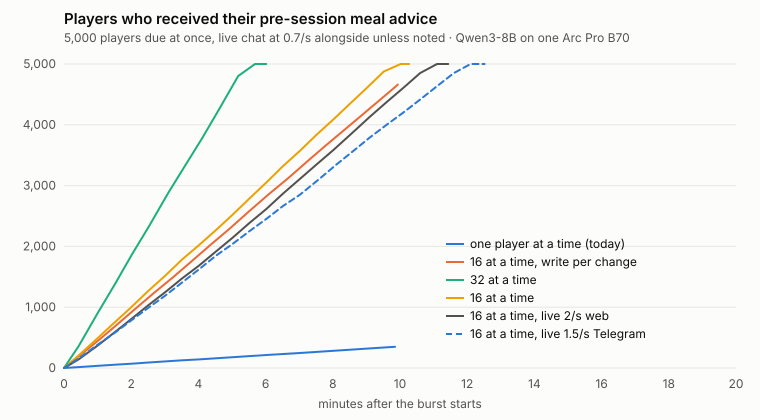
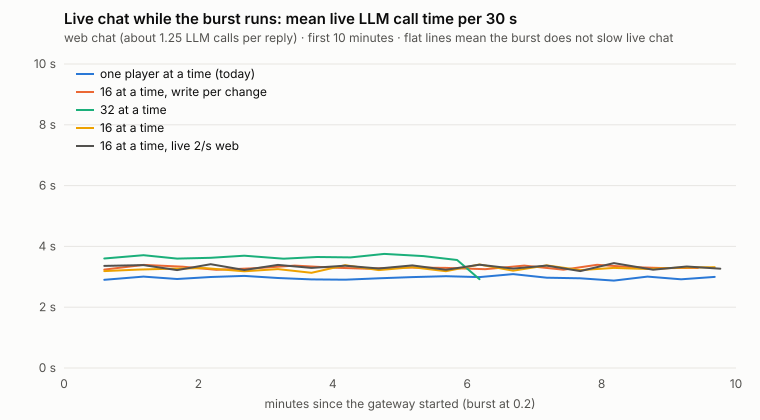
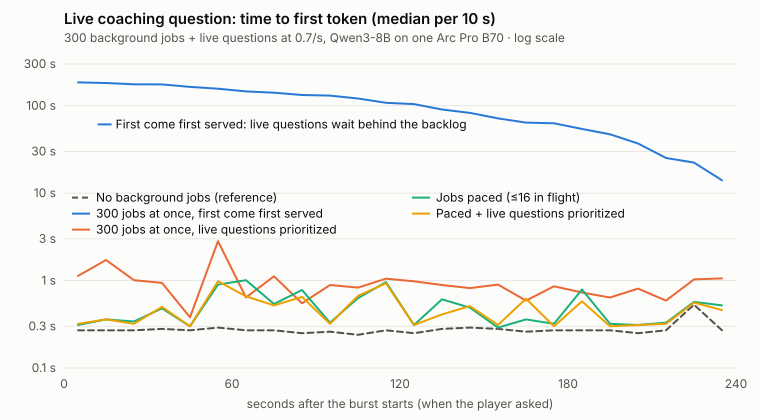
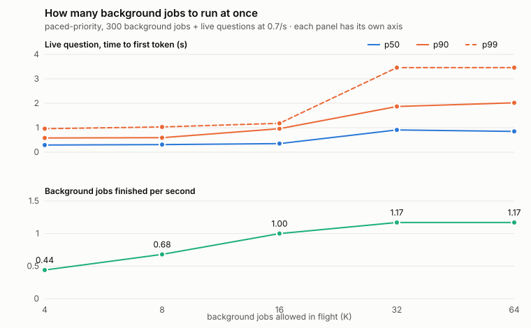

# Serving 5,000 players on one B70: what scheduling changes

Measured on 18 Nov 2026 on the organizer's Intel Arc Pro B70 instance: Qwen3-8B bf16 on GPU 0 under vLLM 0.26 (XPU) with `--scheduling-policy priority`, and Qwen3-Embedding-0.6B on GPU 1.

**Data**

| File | Contents |
|---|---|
| [`docs/bench/full-20261118/results.json`](bench/full-20261118/results.json) | This study: 40 runs |
| [`docs/bench/loadsim-20261118/results.json`](bench/loadsim-20261118/results.json) | The first five-policy comparison |
| [capacity_b70.md](capacity_b70.md) | How many players this supports |

**Reproduce**

```bash
bash server/b70.sh start                   # vLLM with priority scheduling, gateway, web app
bash server/full_bench_b70.sh              # Part A + B (about 2 h 15 min)
bash server/capacity_b70.sh                # capacity sweeps (about 2 h), waits for the first to finish
node server/full_report.mjs bench/full-<timestamp>
```

## The problem

ShuttleCoach messages players on a clock. Three proactive messages exist, and only one of them uses the LLM:

| Message | When | LLM? |
|---|---|---|
| Training reminder | 07:00 (player's `reminderHour`) | No, fixed text from the plan (`tg.todayText`) |
| **Pre-session advice** | 75 min before each training or match | **Yes**: a coach reply with what to eat from the player's pantry (`tg.answerFor(..., "nutrition")`) |
| Check-in | 21:00 on training days with nothing logged | No, fixed text |

When a club trains together, every member's pre-session advice falls due in the same minute. Before this change the gateway had three problems:

1. **Serial loop.** It handled due players one at a time.
2. **No priority.** Every LLM call went to vLLM at the same priority.
3. **One write per change.** It rewrote the whole player file (7.5 MB at 5,000 players) on every change.

## What changed in the gateway

| Change | File | Setting |
|---|---|---|
| Every LLM call carries a lane. Live questions (chat, Telegram, voice, round table) are sent at vLLM priority 0, background work at priority 10. The lane follows the call through async code (`AsyncLocalStorage`), so nothing has to pass it along. | [`agent/src/llm.js`](../agent/src/llm.js) | `LLM_PRIORITY=1`, `LLM_BG_PRIORITY=10` |
| Clock-triggered work runs in a pool with at most K players in flight, in the background lane. | [`agent/src/jobs.js`](../agent/src/jobs.js), `remind()` / `lifeTick()` in [`server.js`](../agent/src/server.js) | `BG_CONCURRENCY=16` |
| Store writes are batched: the file is rewritten at most once per 500 ms and flushed on exit. | [`agent/src/store.js`](../agent/src/store.js) | `STORE_FLUSH_MS=500` (0 = old behaviour) |
| `/api/status` reports both lanes (calls, in flight, mean time), the pool and store write counts. | `server.js` | |

`server/b70.sh start` turns all of this on.

## Part B: the real gateway with 5,000 players

`server/scale_test.mjs` runs a separate copy of the gateway on test data.

- **Players.** 5,000 players, each with club training tomorrow at 19:00, a pantry and memories.
- **The burst.** It calls the real `/api/remind {kind: "presession"}` endpoint, so every player's advice is due at once.
- **Live load.** Live coach questions arrive through `/api/chat` at 0.7 per second, Poisson.
- **Telegram.** A mock Telegram server records every message.

| Run | Meal-advice replies/s | All 5,000 served after | Live chat p50 / p90 / p99 | Live under 10 s | Store writes (time blocked) |
|---|---:|---:|---:|---:|---:|
| **Before**: one player at a time, no priority, write per change | 0.59 | ~141 min (projected from 10 min) | 3.0 / 5.8 / 7.1 s | 100% | 1,055 of 1,055 (31 s) |
| Pool of 16 + priority, write per change | 7.83 | ~11 min (projected) | 3.5 / 6.9 / 7.3 s | 100% | 14,024 of 14,024 (**401 s**) |
| **Pool of 16 + priority + batched writes** (production setting) | 8.54 | **9.8 min** | 3.4 / 6.9 / 7.9 s | 100% | 942 of 15,000 (38 s) |
| Pool of 32 + priority + batched writes | 15.4 | **5.4 min** | 3.8 / 7.7 / 8.8 s | 100% | 557 of 15,000 (23 s) |
| Pool of 16, live web chat at 2/s | 7.65 | 10.9 min | 3.5 / 7.1 / 8.0 s | 100% | 1,058 of 15,000 (43 s) |
| Pool of 16, live **Telegram** at 1.5/s | 6.98 | 11.9 min | 5.6 / 8.4 / 11.0 s | 96.5% | 1,259 of 18,355 (56 s) |





- **The serial loop was the real problem, not latency.** It kept live chat fast, because only one background job ran at a time. But the last player's "what to eat before training" message would have arrived **2 hours 20 minutes** after the first. Their session started 75 minutes after the burst, so most players would get the advice after training.
- **A pool of 16 makes the same work 14× faster:** all 5,000 players in 9.8 minutes. Live chat slows only from p50 3.0 s to 3.4 s, because priority keeps live questions ahead in vLLM's queue.
- **A pool of 32 halves the time again** (5.4 minutes), with live chat p95 8.1 s, still inside 10 s.
- **The old store spent 401 s of a 600 s run writing the player file:** 14,024 full rewrites of 7.5 MB, each about 29 ms, blocking the event loop. Batching turns 15,000 save requests into 942 writes.
- **No request failed in any run:** 25,015 pre-session messages and 4,087 live questions across these six runs.

Earlier model-level estimates (the projection in the first version of this doc, 59 to 83 minutes for 5,000 jobs) were too pessimistic. They used synthetic jobs of 2,000 tokens in and 250 out. A real pre-session reply averages 53 output tokens: 255,089 tokens over 4,824 background calls.

## Part A: model-level policy comparison

`server/loadsim.mjs` sends synthetic requests straight to vLLM, to isolate the scheduling policy:

- **Live:** 1,600 tokens in, 120 out, Poisson at 0.7 per second, for 240 s.
- **Background:** 300 jobs, 2,100 tokens in, 250 out.

### The five policies, three seeds each

Seed 7 is the first run ([loadsim-20261118](bench/loadsim-20261118/results.json)). Seeds 8 and 9 are repeats from this study.

| Policy | Live first token p50 / p90 / p99 (seed 7) | Seeds 8 and 9: TTFT p50 | Meet MLPerf server target² |
|---|---:|---:|---:|
| baseline (no background) | 0.27 / 0.37 / 0.82 s | – | – |
| fcfs-burst: all 300 at once, equal priority | 110 / 180 / 191 s | 94.6 s, 100.6 s | 0% |
| priority-burst: all at once, live first | 0.90 / 1.80 / 3.76 s | – | – |
| paced: 16 in flight, equal priority | 0.36 / 1.26 / 5.17 s | – | – |
| **paced-priority: 16 in flight, live first** | **0.37 / 0.98 / 1.15 s** | 0.34 s, 0.37 s | 98%, 100% |

² TTFT ≤ 2 s and TPOT ≤ 100 ms per request ([MLCommons](https://mlcommons.org/?p=3125)). See [capacity_b70.md](capacity_b70.md).



The repeats agree with the first run within a few percent.

- **First come, first served during a burst** makes a live question wait 1.5 to 3 minutes for its first word.
- **Pacing plus priority** keeps the first word under about 1 second (p99 1.15–1.27 s).

### How many background jobs to run at once

| Background in flight (K) | Live TTFT p50 / p90 / p99 | Live reply p50 / p95 | Meet MLPerf server target | Background jobs/s |
|---:|---:|---:|---:|---:|
| 4 | 0.29 / 0.58 / 0.96 s | 5.3 / 6.5 s | 100% | 0.44 |
| 8 | 0.31 / 0.59 / 1.03 s | 6.2 / 8.1 s | 100% | 0.68 |
| **16** | 0.35 / 0.96 / 1.18 s | 7.8 / 11.2 s | **100%** | **1.00** |
| 32 | 0.91 / 1.87 / 3.46 s | 10.8 / 14.1 s | 79% | 1.17 |
| 64 | 0.85 / 2.02 / 3.46 s | 10.9 / 14.1 s | 78% | 1.17 |



- **16 is the knee.** It is the largest K that keeps every live request inside the MLPerf server target, and gets 85% of the maximum background throughput.
- **Above 16, background gains only 17%** while live latency doubles. 32 and 64 behave the same because vLLM's KV cache (71,488 tokens) holds only about 30 of these jobs.

With the real gateway's short replies, K = 32 is still inside the 10-second reply target (Part B). The default stays at 16, because 16 also holds when replies are long. `BG_CONCURRENCY=32` is a safe override when pre-session advice must go out faster.

### More live traffic during a burst

Paced-priority, K = 16, 300 background jobs:

| Live requests/s | TTFT p50 / p95 | TPOT p95 | Meet MLPerf server target | Background jobs/s |
|---:|---:|---:|---:|---:|
| 0.35 | 0.32 / 1.07 s | 85 ms | 100% | 1.07 |
| 0.7 | 0.35 / 1.05 s | 92 ms | 100% | 1.00 |
| 1.4 | 0.52 / 1.17 s | 111 ms | 80% | 0.88 |
| 2.1 | 1.08 / 2.67 s | 120 ms | 17% | 0.72 |
| 2.8 | 2.50 / 4.71 s | 125 ms | 2% | 0.63 |
| 3.5 | 17.1 / 37.5 s | 120 ms | 0% | 0.56 |

As live load grows, priority shifts the GPU toward live requests: background throughput falls from 1.07 to 0.56 jobs per second. With these long synthetic requests the per-token target breaks first, at about 1.4 per second. Real gateway traffic is much lighter; [capacity_b70.md](capacity_b70.md) measures it end to end.

## What to do

1. **Done, measured: keep pacing and priority on** (`server/b70.sh` sets `LLM_PRIORITY=1`, `BG_CONCURRENCY=16`, `STORE_FLUSH_MS=500`). 5,000 players' pre-session advice goes out in about 10 minutes, and live coach chat stays under 10 seconds throughout.
2. **Spread pre-session generation across its 75-minute window** (follows from the measured rates, not implemented). One message per player is due 75 minutes before the session, so the gateway could start generating up to 60 minutes earlier at a low rate instead of all at once. The evening chat capacity would then stay at its full 3 Telegram questions per second instead of about 1.5 during the burst.
3. **Use the second B70 for a second Qwen3-8B replica** (projection, not measured). GPU 1 only holds the 0.6B embedding model. A second replica would roughly double both live capacity and background throughput.
4. **Move the player store to a database** before going well beyond 10,000 players (follows from the store measurements). Batched writes fixed the blocking at 5,000 players, but each write still serializes the whole file (45 ms at 7.7 MB). SQLite with per-player rows removes the whole-file write.

## Caveats

- Part B players and questions are synthetic. The background job, the store and the HTTP path are the production code, unchanged.
- Each configuration ran once, apart from the seed repeats in Part A. The differences that matter are 10× to 300×.
- "Projected" in the Part B table means the run stopped at 10 minutes and the total is the measured rate × 5,000. Every other "served after" figure is measured to the last player.
- The mock Telegram server answers instantly. Real Telegram adds network time per message. Telegram's bot FAQ also limits bulk sending to about 30 messages per second, so a 5,000-message burst cannot be delivered in under about 3 minutes, whatever the GPU does.
